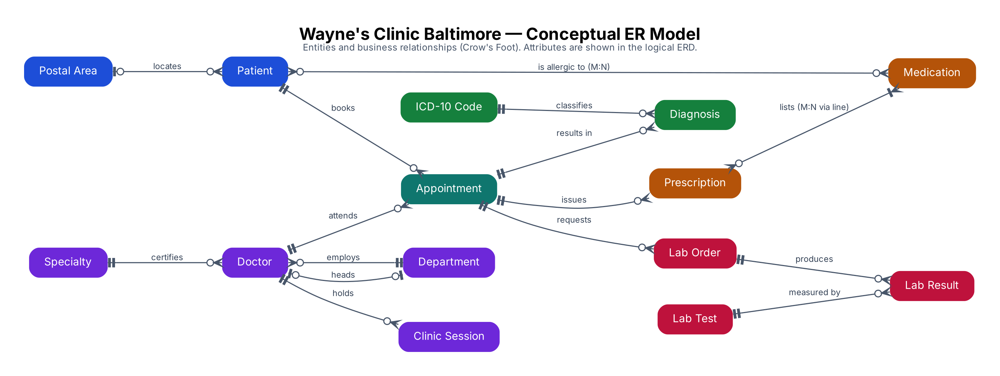
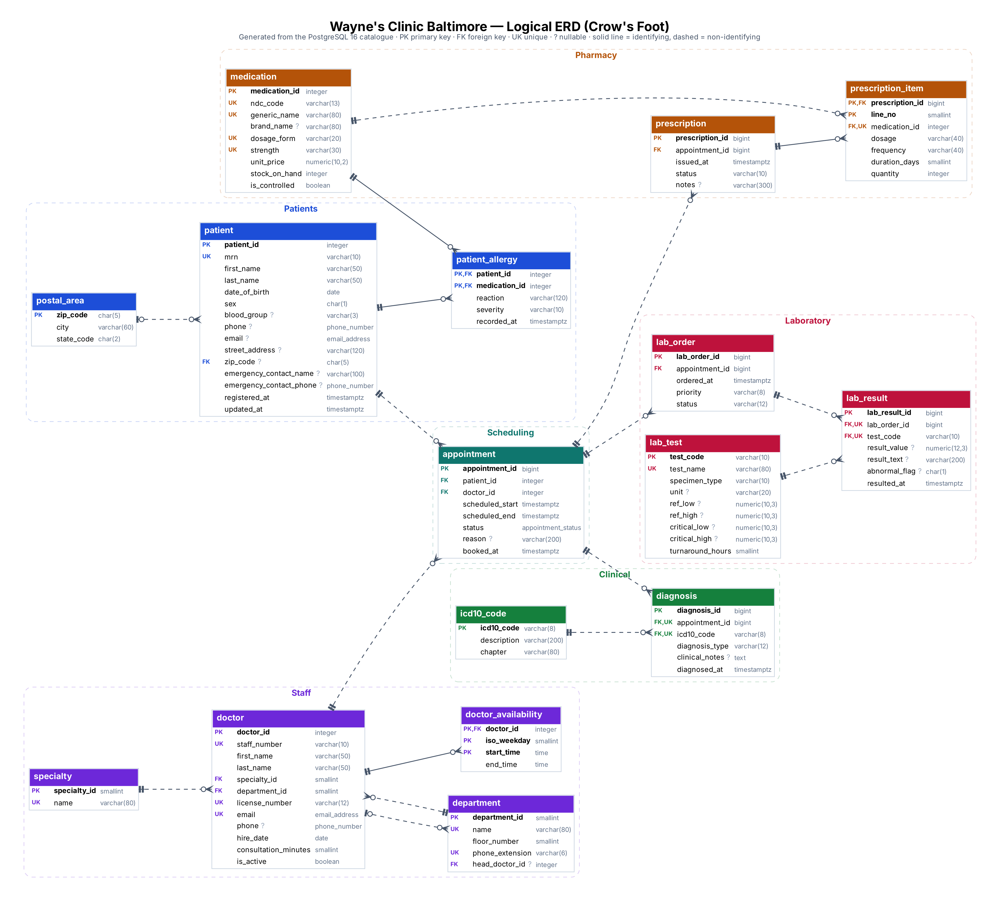
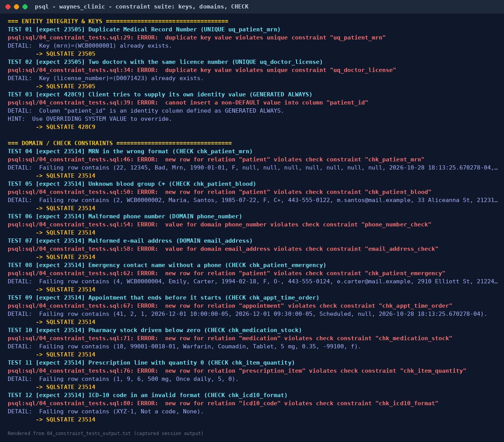
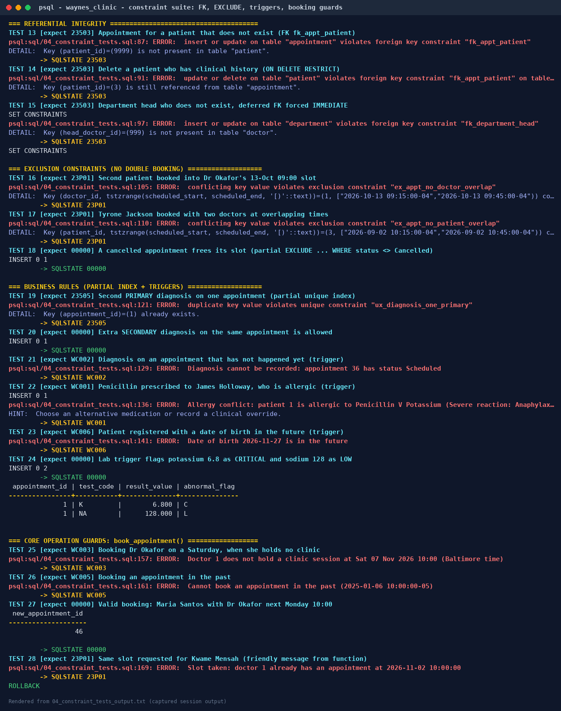
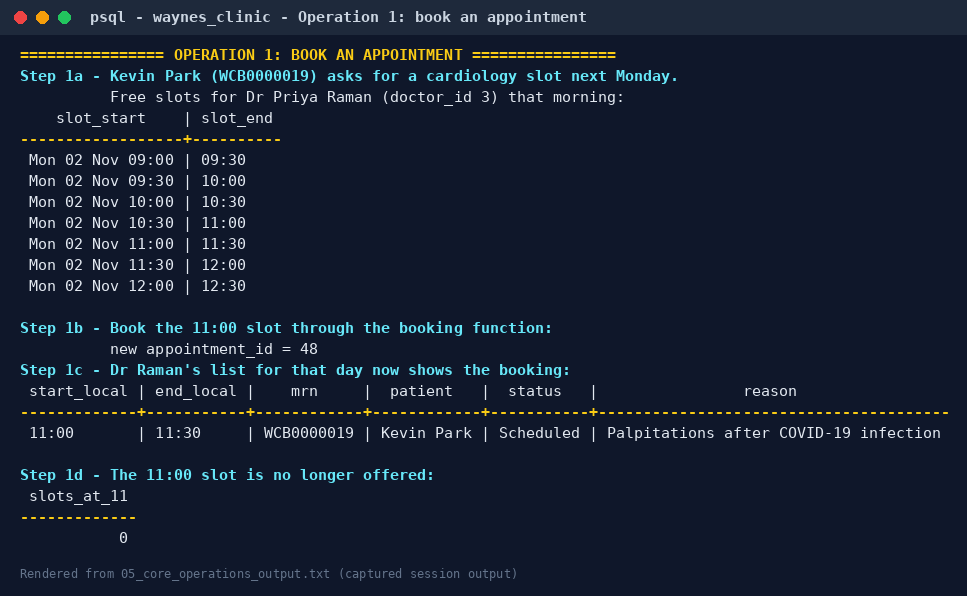
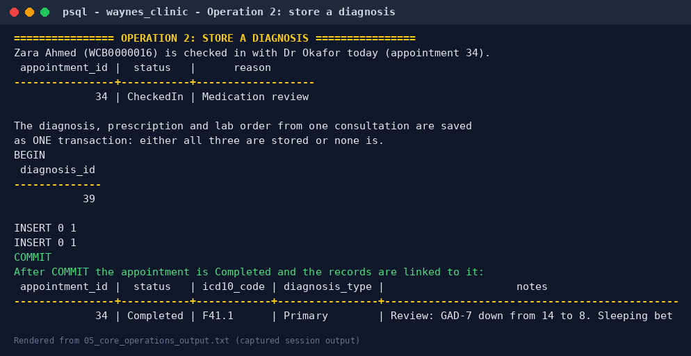
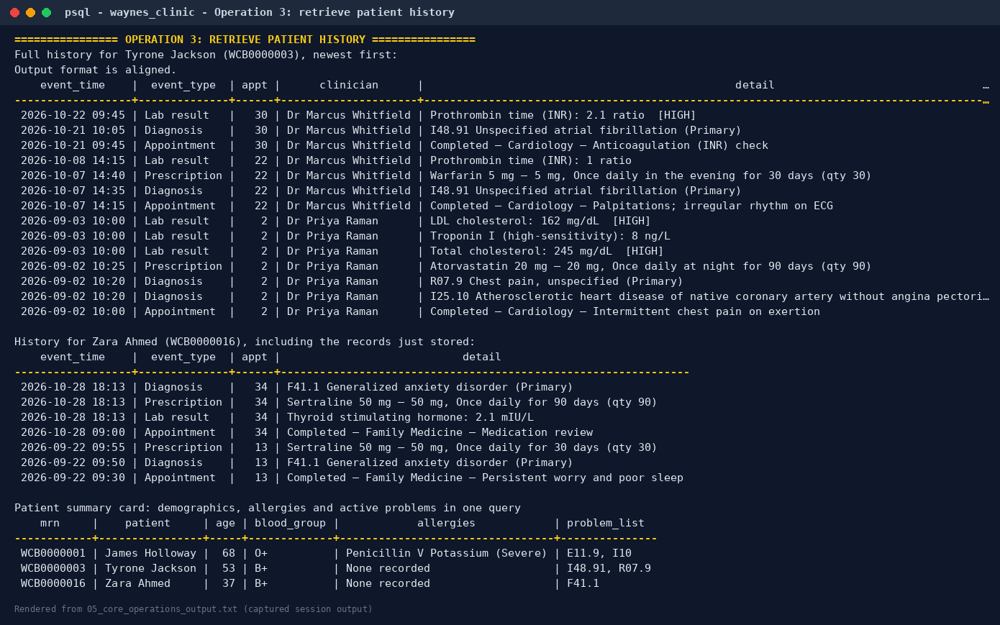
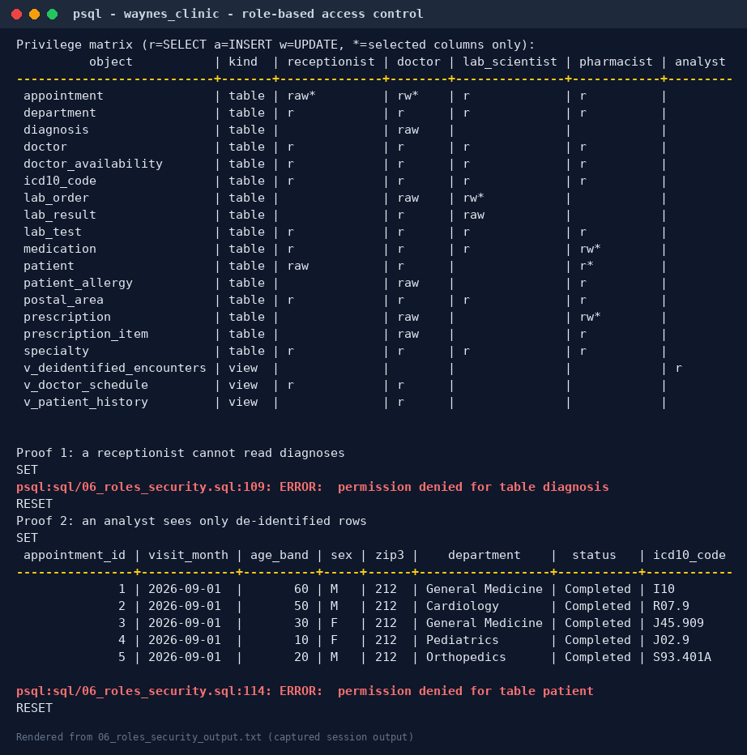

# Portfolio 1 — Database Design and Modelling

**Organisation:** Wayne's Clinic Baltimore (hypothetical) · **Engine:** PostgreSQL 16 · **Schema:** `clinic`

This portfolio takes the clinic from a paper visit form to a fully constrained relational database. It covers the case study, the conceptual and logical ER models, the relational schema with every key and constraint, the normalisation argument, and evidence that the constraints and the three core operations (book an appointment, store a diagnosis, retrieve patient history) work on a real PostgreSQL server.

| Deliverable | Where |
|---|---|
| Case study and business rules | §1, §2 |
| Conceptual ERD / Logical ERD | §3 · `diagrams/erd_conceptual.png`, `diagrams/erd_logical.png` (+ `.svg`, `.dot`) |
| Relational schema | §4 · `sql/01_schema.sql` · `docs/data_dictionary.md` |
| Keys and constraints | §5, §6 · `sql/04_constraint_tests.sql` |
| Normalisation | §7 |
| Core operations and evidence | §8 · `sql/05_core_operations.sql` · `evidence/` |
| Security design | §9 · `sql/06_roles_security.sql` |

---

## 1. Case study: Wayne's Clinic Baltimore

Wayne's Clinic Baltimore is a fictional 10-department outpatient and urgent-care hospital in Baltimore, Maryland. Twelve physicians run weekly clinic sessions across General Medicine, Cardiology, Pediatrics, Orthopedics, Endocrinology, Neurology, Dermatology, Obstetrics and Gynecology, an Emergency department open 08:00–20:00 every day, and a Pathology and Laboratory Medicine department that processes blood, urine and swab tests.

Today the clinic relies on paper visit forms and a shared booking spreadsheet. This causes three recurring problems that the database is designed to remove:

1. **Double bookings.** Two receptionists can give the same 10:00 slot to different patients, and a patient can be booked with two doctors at once.
2. **Fragmented records.** A patient's diagnoses, prescriptions and lab results sit on different forms, so a doctor cannot see the full history in one place.
3. **Unsafe prescribing.** Allergies are written on the front of the paper folder and are easy to miss.

**Scope.** The database stores patients, doctors (with departments, specialties and weekly sessions), appointments, diagnoses coded in ICD-10-CM, prescriptions with one line per medication, and laboratory orders with their results. It must support three core operations:

| Operation | Who | Implemented as |
|---|---|---|
| **Book an appointment** | Receptionist | `available_slots(doctor, date)` and `book_appointment(patient, doctor, start, reason)` |
| **Store a diagnosis** | Doctor | `record_diagnosis(appointment, icd10, type, notes)` inside a transaction with the visit's prescription and lab order |
| **Retrieve patient history** | Doctor | `v_patient_history` view and `get_patient_history(mrn)` |

**Assumptions.** Billing, insurance, inpatient beds and staff rostering are out of scope. All times are stored as `timestamptz` and displayed in Baltimore time (America/New_York). All people in the sample data are fictional; phone numbers use the reserved 555-01xx range and drug NDC codes are illustrative. ICD-10-CM codes are real.

## 2. Business rules and how each is enforced

A rule enforced in the database holds for every application that touches the data, so wherever possible each rule below is declared in the schema rather than left to application code. The *Test* column refers to the automated suite in `sql/04_constraint_tests.sql`.

| # | Business rule | Enforced by | Test |
|---|---|---|---|
| BR1 | Every patient has one unique Medical Record Number of the form `WCB` + 7 digits | `UNIQUE` + `CHECK` on `patient.mrn` | 01, 04 |
| BR2 | A doctor's staff number, state licence number and e-mail are each unique | three `UNIQUE` constraints | 02 |
| BR3 | Ids are generated by the database and cannot be forged | `GENERATED ALWAYS AS IDENTITY` | 03 |
| BR4 | Phone numbers, e-mails, blood groups and sex codes take only valid values | `DOMAIN`s and `CHECK`s | 05–08 |
| BR5 | An appointment ends after it starts and lasts at most two hours | `CHECK` constraints | 09 |
| BR6 | **A doctor cannot have two overlapping live appointments** | `EXCLUDE USING gist (doctor_id WITH =, tstzrange(...) WITH &&)` | 16 |
| BR7 | **A patient cannot be in two appointments at once** | second `EXCLUDE` constraint | 17 |
| BR8 | A cancelled appointment releases its slot | `WHERE (status <> 'Cancelled')` on both exclusions | 18 |
| BR9 | Bookings must fall inside the doctor's clinic sessions and in the future | `book_appointment()` (WC003, WC005) | 25–28 |
| BR10 | Diagnoses, prescriptions and lab orders only for attended appointments | trigger `fn_require_attended_appointment` (WC002) | 21 |
| BR11 | At most one *Primary* diagnosis per appointment | partial unique index `ux_diagnosis_one_primary` | 19, 20 |
| BR12 | **Never prescribe a drug the patient is allergic to** | trigger `fn_prescription_allergy_check` (WC001) | 22 |
| BR13 | Pharmacy stock can never go negative | `CHECK (stock_on_hand >= 0)` | 10 |
| BR14 | Patients with clinical history cannot be deleted | `ON DELETE RESTRICT` foreign keys | 14 |
| BR15 | Each department may have a head who is one of its doctors | deferrable FK `fk_department_head` | 15 |
| BR16 | Lab results are flagged Normal / Low / High / Critical automatically | trigger `fn_lab_result_flag` | 24 |

## 3. Entity-Relationship modelling

### 3.1 Conceptual model



The conceptual model names fourteen business entities and the verbs that connect them. Two relationships are many-to-many in the business view and are resolved into associative entities in the logical model: a patient *is allergic to* many medications (→ `patient_allergy`) and a prescription *lists* many medications (→ `prescription_item`). `Appointment` is itself an associative entity between `Patient` and `Doctor`, but it carries its own attributes (time, status, reason) and is the anchor for every clinical record, so it is modelled as a full entity.

### 3.2 Logical model (Crow's Foot)



The logical ERD is generated directly from the PostgreSQL catalogue by `diagrams/generate_erd.py`, so it always matches the deployed schema. Solid lines are identifying relationships (the foreign key is part of the child's primary key: `doctor_availability`, `patient_allergy`, `prescription_item`). Dashed lines are non-identifying.

### 3.3 Relationship cardinalities

| Parent | Child | Cardinality | Participation | Meaning |
|---|---|---|---|---|
| patient | appointment | 1 : 0..* | appointment mandatory | A patient books zero or more appointments; each appointment is for exactly one patient |
| doctor | appointment | 1 : 0..* | appointment mandatory | A doctor attends zero or more appointments |
| department | doctor | 1 : 0..* | doctor mandatory | Every doctor belongs to exactly one department |
| doctor | department (head) | 0..1 : 0..* | optional both sides | A department may have a head; circular reference handled with a deferrable FK |
| specialty | doctor | 1 : 0..* | doctor mandatory | One primary board specialty per doctor |
| doctor | doctor_availability | 1 : 0..* | identifying | Weekly sessions are a weak entity of the doctor |
| appointment | diagnosis | 1 : 0..* | diagnosis mandatory | A visit can produce several diagnoses (one Primary) |
| icd10_code | diagnosis | 1 : 0..* | diagnosis mandatory | Every diagnosis is coded |
| appointment | prescription | 1 : 0..* | prescription mandatory | |
| prescription | prescription_item | 1 : 0..* | identifying | Resolves prescription M:N medication |
| medication | prescription_item | 1 : 0..* | | |
| patient / medication | patient_allergy | M : N | identifying | Resolves patient M:N medication |
| appointment | lab_order | 1 : 0..* | | |
| lab_order | lab_result | 1 : 0..* | | One result per test per order (`UNIQUE (lab_order_id, test_code)`) |
| lab_test | lab_result | 1 : 0..* | | |
| postal_area | patient | 0..1 : 0..* | patient address optional | |

## 4. Relational schema

Notation: **bold** = primary key, *italic* = foreign key (→ referenced table), UK = alternate (candidate) key. The full DDL is in [`sql/01_schema.sql`](sql/01_schema.sql) and every column, type and constraint is listed in the generated [data dictionary](docs/data_dictionary.md).

```
POSTAL_AREA        (zip_code, city, state_code)
DEPARTMENT         (department_id, name UK, floor_number, phone_extension UK, head_doctor_id → DOCTOR)
SPECIALTY          (specialty_id, name UK)
DOCTOR             (doctor_id, staff_number UK, first_name, last_name, specialty_id → SPECIALTY,
                    department_id → DEPARTMENT, license_number UK, email UK, phone, hire_date,
                    consultation_minutes, is_active)
DOCTOR_AVAILABILITY(doctor_id → DOCTOR, iso_weekday, start_time, end_time)          PK = (doctor_id, iso_weekday, start_time)
PATIENT            (patient_id, mrn UK, first_name, last_name, date_of_birth, sex, blood_group, phone,
                    email, street_address, zip_code → POSTAL_AREA, emergency_contact_name,
                    emergency_contact_phone, registered_at, updated_at)
MEDICATION         (medication_id, ndc_code UK, generic_name, brand_name, dosage_form, strength,
                    unit_price, stock_on_hand, is_controlled)     UK = (generic_name, dosage_form, strength)
PATIENT_ALLERGY    (patient_id → PATIENT, medication_id → MEDICATION, reaction, severity, recorded_at)
APPOINTMENT        (appointment_id, patient_id → PATIENT, doctor_id → DOCTOR, scheduled_start,
                    scheduled_end, status, reason, booked_at)
ICD10_CODE         (icd10_code, description, chapter)
DIAGNOSIS          (diagnosis_id, appointment_id → APPOINTMENT, icd10_code → ICD10_CODE,
                    diagnosis_type, clinical_notes, diagnosed_at)  UK = (appointment_id, icd10_code)
PRESCRIPTION       (prescription_id, appointment_id → APPOINTMENT, issued_at, status, notes)
PRESCRIPTION_ITEM  (prescription_id → PRESCRIPTION, line_no, medication_id → MEDICATION, dosage,
                    frequency, duration_days, quantity)           UK = (prescription_id, medication_id)
LAB_TEST           (test_code, test_name UK, specimen_type, unit, ref_low, ref_high,
                    critical_low, critical_high, turnaround_hours)
LAB_ORDER          (lab_order_id, appointment_id → APPOINTMENT, ordered_at, priority, status)
LAB_RESULT         (lab_result_id, lab_order_id → LAB_ORDER, test_code → LAB_TEST, result_value,
                    result_text, abnormal_flag, resulted_at)       UK = (lab_order_id, test_code)
```

Sixteen tables, three views (`v_patient_history`, `v_doctor_schedule`, `v_deidentified_encounters`), four operational functions and four trigger functions attached through six triggers.

## 5. Keys

**Primary keys — surrogate vs natural.** Entities whose natural identifiers are long, can change, or are personal data (patients, doctors, appointments, clinical records) use `GENERATED ALWAYS AS IDENTITY` surrogates. A patient's MRN or a doctor's licence number may be re-issued, and putting them in every foreign key would spread personal identifiers across the database. Reference tables whose codes are short, stable and meaningful use the natural code as the primary key: `icd10_code`, `lab_test.test_code` and `postal_area.zip_code`. A row in `diagnosis` that reads `I10` is self-explanatory without a join.

**Candidate (alternate) keys** are all declared `UNIQUE`: `patient.mrn`; `doctor.staff_number`, `license_number` and `email`; `medication.ndc_code` and `(generic_name, dosage_form, strength)`; `department.name` and `phone_extension`; `lab_test.test_name`. Declaring them makes the optimiser aware of uniqueness and stops duplicate registrations.

**Composite keys** identify weak entities: `doctor_availability (doctor_id, iso_weekday, start_time)`, `patient_allergy (patient_id, medication_id)` and `prescription_item (prescription_id, line_no)`.

**Foreign keys and their delete rules**

| Rule | Used on | Reason |
|---|---|---|
| `ON DELETE RESTRICT` | appointment → patient/doctor; diagnosis, prescription, lab_order → appointment; references to icd10/medication/lab_test | Medical records must be retained for years under state and federal rules; deleting a parent must fail |
| `ON DELETE CASCADE` | prescription_item → prescription; lab_result → lab_order; doctor_availability → doctor; patient_allergy → patient | The child has no meaning without its parent (weak entities / document lines) |
| `ON DELETE SET NULL` + `DEFERRABLE INITIALLY DEFERRED` | department.head_doctor_id → doctor | Circular reference: a department and its head can be created in one transaction, checked at `COMMIT` |
| `ON UPDATE CASCADE` | references to natural keys (ZIP, ICD-10 code, test code) | If a code is corrected, every reference follows |

PostgreSQL does not index foreign-key columns automatically. Indexes are created on the foreign keys used for lookups by department, specialty, ZIP, ICD-10 code, medication and test. `diagnosis(appointment_id)` and `lab_result(lab_order_id)` are already served by the leading column of their composite `UNIQUE` constraints. The remaining three FK columns on the patient-history path are deliberately left un-indexed so Portfolio 2 can measure the effect of adding them.

## 6. Constraints

| Constraint type | Examples in this schema |
|---|---|
| `NOT NULL` | All keys, names, dates of birth, appointment times, diagnosis codes |
| `CHECK` (row-level) | MRN/licence/staff-number formats, blood group, sex, appointment duration, `stock_on_hand >= 0`, `ref_low < ref_high`, critical limits outside the reference range, emergency contact name and phone both present or both absent |
| `DOMAIN` (reusable type + check) | `phone_number`, `email_address` |
| `ENUM` type | `appointment_status` (Scheduled → CheckedIn → Completed / Cancelled / NoShow) |
| `UNIQUE` | All candidate keys above |
| Partial `UNIQUE` index | One Primary diagnosis per appointment |
| `EXCLUDE` (GiST) | No overlapping appointments per doctor and per patient, ignoring cancelled ones |
| Triggers | Allergy check, attended-appointment check, future-DOB check, lab-result flagging |

The exclusion constraints are the strongest design feature. A check-then-insert in application code ("is the slot free? then insert") has a race window between the check and the insert. The exclusion constraint is enforced by the index itself, so even two receptionists clicking at the same instant cannot double-book. Portfolio 3 demonstrates this under real concurrency.

### Evidence — automated constraint test suite

`sql/04_constraint_tests.sql` attempts 28 operations, 23 of which should be rejected and 5 accepted, and records the SQLSTATE that PostgreSQL returns. The whole suite runs in one transaction that is rolled back, so the sample data is unchanged.

**28/28 tests behaved as expected** (full table in [`evidence/constraint_test_summary.md`](evidence/constraint_test_summary.md), raw log in [`evidence/04_constraint_tests_output.txt`](evidence/04_constraint_tests_output.txt)).





## 7. Normalisation

### 7.1 Starting point: the paper visit form (UNF)

The clinic's paper "Visit Record" holds everything about one consultation on one sheet. As a single unnormalised relation, with repeating groups in braces:

```
VISIT_RECORD ( visit_no, visit_datetime,
               patient_mrn, patient_name, date_of_birth, street_address, zip, city, state,
               staff_no, doctor_name, specialty, department, dept_floor,
               { icd_code, icd_description, diagnosis_type },
               { ndc_code, drug_name, strength, dosage, frequency, days, quantity },
               { test_code, test_name, unit, ref_range, result_value } )
```

### 7.2 Functional dependencies

| FD | Dependency |
|---|---|
| FD1 | visit_no → visit_datetime, patient_mrn, staff_no |
| FD2 | patient_mrn → patient_name, date_of_birth, street_address, zip |
| FD3 | zip → city, state |
| FD4 | staff_no → doctor_name, specialty, department |
| FD5 | department → dept_floor |
| FD6 | icd_code → icd_description |
| FD7 | (visit_no, icd_code) → diagnosis_type |
| FD8 | ndc_code → drug_name, strength |
| FD9 | (visit_no, ndc_code) → dosage, frequency, days, quantity |
| FD10 | test_code → test_name, unit, ref_range |
| FD11 | (visit_no, test_code) → result_value |
| MVDs | visit_no ↠ icd_code · visit_no ↠ ndc_code · visit_no ↠ test_code (three *independent* multi-valued facts) |

**Anomalies in UNF.** Changing Dr Okafor's department means editing every visit she ever had (update anomaly). A new drug cannot be recorded until someone is prescribed it (insertion anomaly). Shredding the only visit of a patient loses the patient (deletion anomaly).

### 7.3 First Normal Form

1NF requires atomic values and no repeating groups. Each repeating group becomes its own relation keyed by the visit plus the group's identifier:

```
VISIT            (visit_no, visit_datetime, patient_mrn, patient_name, date_of_birth, street_address,
                  zip, city, state, staff_no, doctor_name, specialty, department, dept_floor)
VISIT_DIAGNOSIS  (visit_no, icd_code, icd_description, diagnosis_type)
VISIT_DRUG       (visit_no, ndc_code, drug_name, strength, dosage, frequency, days, quantity)
VISIT_TEST       (visit_no, test_code, test_name, unit, ref_range, result_value)
```

Flattening all three groups into one table keyed on `(visit_no, icd_code, ndc_code, test_code)` would also be 1NF, but a visit with 2 diagnoses, 2 drugs and 3 tests would need 2 × 2 × 3 = 12 rows. That is the multivalued-dependency redundancy 4NF forbids, so the groups are separated from the start.

### 7.4 Second Normal Form

2NF removes partial dependencies on a composite key. In `VISIT_DIAGNOSIS`, `icd_description` depends on `icd_code` alone (FD6). The same applies to drug name/strength (FD8) and test name/unit/range (FD10):

```
ICD10_CODE         (icd_code, icd_description)
MEDICATION         (ndc_code, drug_name, strength)
LAB_TEST           (test_code, test_name, unit, ref_range)
DIAGNOSIS          (visit_no, icd_code, diagnosis_type)
PRESCRIPTION_LINE  (visit_no, ndc_code, dosage, frequency, days, quantity)
LAB_RESULT         (visit_no, test_code, result_value)
```

`VISIT` has a single-attribute key, so it is already in 2NF.

### 7.5 Third Normal Form

3NF removes transitive dependencies (non-key → non-key). `VISIT` contains three chains: visit_no → patient_mrn → patient details (FD2), patient_mrn → zip → city/state (FD3), and visit_no → staff_no → doctor details → department → floor (FD4, FD5). Each determinant becomes its own relation:

```
APPOINTMENT  (visit_no, visit_datetime, patient_mrn → PATIENT, staff_no → DOCTOR)
PATIENT      (patient_mrn, patient_name, date_of_birth, street_address, zip → POSTAL_AREA)
POSTAL_AREA  (zip, city, state)
DOCTOR       (staff_no, doctor_name, specialty → SPECIALTY, department → DEPARTMENT)
DEPARTMENT   (department, dept_floor)
SPECIALTY    (specialty)
```

### 7.6 Boyce-Codd and Fourth Normal Form

A relation is in BCNF when every determinant is a candidate key. Checking the final schema:

- `doctor`: determinants `doctor_id`, `staff_number`, `license_number` and `email` are all candidate keys. **BCNF.**
- `appointment`: `appointment_id` is the key. Because the exclusion constraint forbids overlaps, `(doctor_id, scheduled_start)` and `(patient_id, scheduled_start)` are also candidate keys, and they determine the remaining attributes. Every determinant is a key. **BCNF.**
- `medication`: `ndc_code` and `(generic_name, dosage_form, strength)` are both candidate keys. **BCNF.**
- `lab_result`: `lab_result_id` and `(lab_order_id, test_code)` are candidate keys. **BCNF.**

The three independent multi-valued facts about a visit live in separate relations (`diagnosis`, `prescription_item` via `prescription`, `lab_result` via `lab_order`), and allergies are separate from prescriptions. **No non-trivial MVD remains, so the schema is in 4NF.**

### 7.7 From the normalised model to the final schema

Three refinements were made on top of the pure normalisation output, each driven by how the clinic works:

1. **Header/line documents.** A prescription has its own status and notes, and a lab order has its own priority and status. These depend on the document, not on the visit or the line, so `prescription` and `lab_order` headers were introduced (`prescription_id → appointment_id, status`). This is still BCNF.
2. **Surrogate keys** replace `visit_no`, `patient_mrn` and `staff_no` as primary keys, with the business keys kept as `UNIQUE` (see §5).
3. **Weekly sessions** (`doctor_availability`) are a new fact the paper form never captured, needed by the booking operation.

### 7.8 Deliberate, controlled redundancy

Two stored values could in theory be derived. Both are kept because they record facts **as they were at a point in time**:

| Column | Could be derived from | Why it is stored |
|---|---|---|
| `lab_result.abnormal_flag` | `result_value` + `lab_test` ranges | Reference ranges are revised. A result flagged High in 2026 must still read High in 2030 even if the range changes. A trigger computes it on insert, so it can never be wrong at the time of filing. |
| `appointment.scheduled_end` | `scheduled_start` + `doctor.consultation_minutes` | Slot lengths change and some visits are booked as double slots. The exclusion constraint also needs the stored range. |

## 8. Core operations — evidence

The full session log is [`evidence/05_core_operations_output.txt`](evidence/05_core_operations_output.txt).

**Operation 1 — book an appointment.** `available_slots()` lists Dr Raman's free slots, `book_appointment()` validates the doctor, the session and the time, then inserts. The exclusion constraint guarantees the slot cannot be given away twice, and the slot disappears from the free list.



**Operation 2 — store a diagnosis.** The diagnosis, the repeat prescription and the lab order raised in one consultation are saved in **one transaction**, so the record is never half-written. `record_diagnosis()` moves the appointment from *CheckedIn* to *Completed*.



**Operation 3 — retrieve patient history.** `get_patient_history('WCB0000003')` merges appointments, diagnoses, prescriptions and flagged lab results from four tables into one chronological timeline.



## 9. Security design (least privilege)

Patient data is Protected Health Information under the US HIPAA Privacy and Security Rules, so access is role-based. `sql/06_roles_security.sql` creates five group roles. Receptionists can register patients and book, but cannot read diagnoses. Lab scientists see orders and results only. Pharmacists see prescriptions, allergies and five patient columns. Analysts see only `v_deidentified_encounters`, which follows the HIPAA Safe Harbor approach: 10-year age bands, 3-digit ZIP and month-level dates.



## 10. How to run

```bash
# PostgreSQL 16 running locally; adjust PGHOST/PGUSER/PGPASSWORD as needed
pip install "psycopg[binary]" pillow      # plus Graphviz for the ERDs
./run_portfolio1.sh                        # rebuilds DB, runs tests, regenerates every artefact
```

Or run the SQL files in order with `psql`: `00_create_database.sql` (as superuser), then `01` → `06` against `waynes_clinic`.

## 11. Files

```
sql/00_create_database.sql          database, encoding, time zone
sql/01_schema.sql                   16 tables, domains, enum, keys, CHECK/EXCLUDE constraints, FK indexes
sql/02_functions_triggers_views.sql triggers, booking/diagnosis/history functions, views
sql/03_seed_data.sql                fictional sample data (20 patients, 12 doctors, 40 appointments ...)
sql/04_constraint_tests.sql         28-case constraint test suite (rolled back)
sql/05_core_operations.sql          the three core operations end to end
sql/06_roles_security.sql           RBAC roles, de-identified view, privilege matrix
diagrams/                           conceptual + logical ERD (.png, .svg, .dot) and generator
docs/data_dictionary.md             generated data dictionary
evidence/                           raw psql logs, test summary and rendered evidence images
run_portfolio1.sh                   one-command rebuild
```
